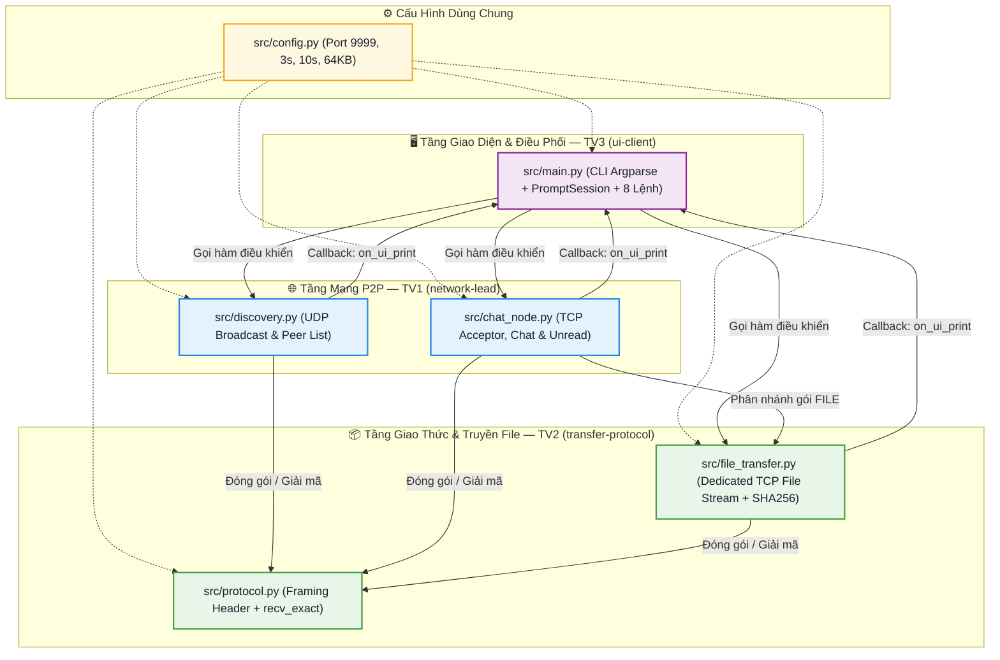
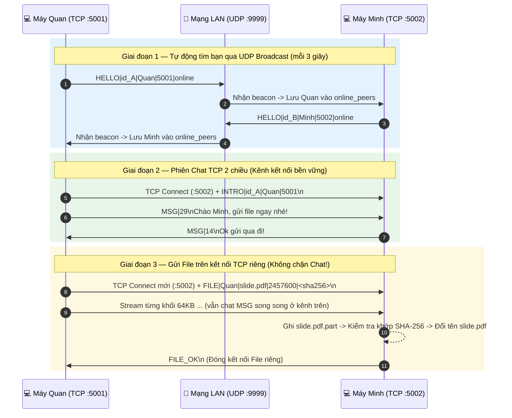

<div align="center">

# 🌐 LAN Chat & File Sharing P2P

### Ứng Dụng Trò Chuyện & Truyền File Ngang Hàng Qua Mạng Cục Bộ (TCP & UDP Native Sockets)

[](https://www.python.org/)
[](https://docs.python.org/3/library/socket.html)
[](#giao-thuc)
[](https://python-prompt-toolkit.readthedocs.io/)
[](#giao-thuc)

**Đồ Án Môn Mạng Máy Tính — Nhóm `Team3p-MangMayTinh` (3 thành viên)**  
📦 Repository: [`github.com/bap-CROUH/Team3p-MangMayTinh`](https://github.com/bap-CROUH/Team3p-MangMayTinh)

[🎯 Barem 100%](#barem) •
[🏗️ Kiến Trúc 6 File](#kien-truc) •
[🚀 Khởi Chạy Nhanh](#khoi-chay) •
[⌨️ Bộ Lệnh CLI](#lenh-cli) •
[⚡ Đa Luồng & Sequence](#da-luong) •
[🔐 Giao Thức](#giao-thuc) •
[🤝 Quy Tắc Nhóm](#quy-tac-nhom)

</div>

---

## ✨ Điểm Nhấn Kỹ Thuật

Ứng dụng cho phép các máy tính trong cùng mạng **LAN / Wi-Fi** (hoặc nhiều cửa sổ Terminal trên cùng 1 máy) **tự động tìm thấy nhau không cần máy chủ trung tâm (Serverless P2P)**, trò chuyện hai chiều thời gian thực và gửi file dung lượng lớn song song mà không làm đơ khung gõ phím:

- 📡 **UDP Broadcast (`Port 9999`) — Nhanh & Tự động:** Quảng bá tín hiệu hiện diện mỗi `3 giây`, cập nhật trạng thái `online` / `away` tức thì, tự động loại bỏ peer mất kết nối sau `10 giây`.
- 💬 **TCP Byte-Stream Chat — Tin cậy & Đa phiên:** Đóng khung bản tin (`Message Framing`) chống dính/cắt gói, định danh kết nối qua gói `INTRO`, lưu tin nhắn chờ kèm bộ đếm **`unread`** khi có người khác nhắn tới.
- 📁 **Truyền File Kênh TCP Độc Lập — Không Nghẽn Chat:** Mở kết nối TCP riêng cho mỗi lượt `/send`, truyền theo từng khối `64 KB` (không tràn RAM), kiểm tra toàn vẹn **`SHA-256`** và tự xóa file tạm `.part` nếu rớt mạng.
- 🖥️ **Giao Diện Console Chống Đè Chữ:** Tích hợp `PromptSession` + `patch_stdout()` giữ nguyên dòng chữ đang gõ dở `> ...` ngay cả khi tin nhắn và tiến độ tải file đổ về liên tục.

---

<a id="barem"></a>
## 1. 🎯 Đối Chiếu Mục Tiêu & Barem Chấm Điểm (100%)

| # | Hạng mục chấm điểm | Tỷ trọng | Module cốt lõi | Cơ chế đạt trọn điểm |
| :-: | :--- | :-: | :--- | :--- |
| **01** | **UDP Discovery, Online List & Status** | `15%` | `src/discovery.py` | Phát `HELLO` mỗi `3s` (`SO_REUSEADDR`, `SO_BROADCAST`), xóa peer sau `10s` timeout, đổi `/status online\|away`, lọc gói của chính mình bằng `peer_id`. |
| **02** | **TCP Chat 2 chiều & Đa Peer (Unread)** | `20%` | `src/chat_node.py` | Gửi/nhận mọi lúc không chờ lượt, tái sử dụng kết nối hai chiều mở sẵn, gom hộp thư chờ & báo `[*] New message from X (N unread)`. |
| **03** | **File Transfer có `%` tiến độ, lưu chuẩn** | `15%` | `src/file_transfer.py` | Chạy luồng riêng + **socket TCP riêng** không chặn chat, báo tiến độ mốc `25% · 50% · 75% · 100%`, lưu vào `downloads/`, đối chiếu `SHA-256`. |
| **04** | **Console UI không vỡ chữ khi đang gõ** | `15%` | `src/main.py` | `PromptSession` + `patch_stdout()` bọc trong `threading.Lock()`, chèn tin mới lên trên dòng nhập liệu một cách mượt mà. |
| **05** | **Thiết kế Giao thức & Message Framing** | `10%` | `src/protocol.py` | Tách dòng Header kết thúc bằng `\n` (`recv_line`) + đọc đúng số byte payload (`recv_exact`), an toàn với tiếng Việt UTF-8 và ký tự `\|`. |
| **06** | **Xử lý lỗi & Độ ổn định hệ thống** | `10%` | Toàn bộ `src/` | Peer tắt đột ngột không văng app; kết nối peer offline báo lỗi gọn; đứt mạng tự xóa `.part`; lọc `os.path.basename` chống `../`; xử lý file `0 byte`. |
| **07** | **Báo cáo kỹ thuật (5–10 trang) & Wireshark** | `10%` | `docs/` | Phân tích kiến trúc, 6 luồng, đóng khung TCP, kèm ảnh chụp Wireshark gói UDP Broadcast `9999` và bắt tay 3 bước TCP (`SYN` / `SYN-ACK` / `ACK`). |
| **08** | **Demo trực tiếp (2+ máy) & Chất lượng Code** | `5%` | Nhánh `main` | Kiến trúc 6 file phẳng (~400–500 dòng), tách hằng số vào `config.py` giúp cả 3 thành viên đọc hiểu 100% và sửa **live-coding** trong 30 giây. |

---

<a id="kien-truc"></a>
## 2. 🏗️ Kiến Trúc 6 File Phẳng & Sơ Đồ Hệ Thống

> [!TIP]
> **Tại sao dùng cấu trúc 6 file phẳng trong `src/`?**  
> Thay vì chia nhỏ hàng chục thư mục con rườm rà, 6 module phẳng giúp luồng dữ liệu đi thẳng một mạch, không bị import vòng, cực kỳ dễ nhớ khi trả lời câu hỏi chéo và sửa trực tiếp trước mặt giảng viên.



### 📂 Cây Thư Mục Dự Án

```text
Team3p-MangMayTinh/
├── 💻 src/                                  # Mã nguồn cốt lõi (Python Native Socket)
│   ├── config.py                            # [Chung] Hằng số hệ thống (sửa nhanh khi vấn đáp)
│   ├── protocol.py                          # [TV2] Đóng gói/bóc tách Header & recv_line / recv_exact
│   ├── discovery.py                         # [TV1] UDP Broadcaster (3s), Listener & Timeout Cleaner (10s)
│   ├── chat_node.py                         # [TV1] TCP Acceptor, kết nối P2P 2 chiều & hộp thư Unread
│   ├── file_transfer.py                     # [TV2] Truyền/nhận file trên socket TCP riêng, .part & SHA-256
│   └── main.py                              # [TV3] Khởi chạy CLI, PromptSession chống vỡ chữ & 8 lệnh
│
├── 📥 downloads/                            # Nơi lưu file nhận được (tự động dọn sạch .part khi lỗi)
│
├── 🧪 tests/                                # Bộ kiểm thử tự động (unittest)
│   ├── test_protocol.py                     # Test dính gói, cắt lẻ 1 byte, tiếng Việt UTF-8, ký tự '|'
│   ├── test_discovery.py                    # Test lọc self-beacon bằng peer_id, đổi status & timeout 10s
│   └── test_file_transfer.py                # Test file 0 byte, file lớn, trùng tên, chống '../', xóa .part
│
├── 📄 docs/                                 # Hồ sơ kế hoạch, bằng chứng mạng & báo cáo
│   ├── TODO_LIST.md                         # Hướng dẫn code chi tiết từng hàm cho 3 thành viên
│   ├── KeHoach_DoAn_MMT_Den_08_12.xlsx      # Bảng tiến độ Excel 5 Sheet & kịch bản Live-coding
│   ├── wireshark/                           # Ảnh chụp gói tin UDP Broadcast & TCP 3-Way Handshake
│   └── presentation/                        # Báo cáo kỹ thuật (5–10 trang) & Slide thuyết trình
│
├── .gitignore
└── requirements.txt                         # Duy nhất 1 thư viện UI: prompt_toolkit
```

---

<a id="khoi-chay"></a>
## 3. 🚀 Hướng Dẫn Cài Đặt, Khởi Chạy & Kiểm Thử

### 3.1. Cài đặt môi trường
Yêu cầu **Python 3.9+** trên Windows, macOS hoặc Linux:
```bash
pip install -r requirements.txt
```

### 3.2. Kịch bản 1 — Chạy thử nhiều người dùng trên **1 máy tính**
Mở 3 cửa sổ Terminal tại thư mục gốc dự án, đặt cổng TCP (`--port`) khác nhau cho mỗi người:
```bash
# Terminal 1 — Quan
python src/main.py --name Quan --port 5001

# Terminal 2 — Minh
python src/main.py --name Minh --port 5002

# Terminal 3 — Huy
python src/main.py --name Huy --port 5003
```

> [!NOTE]
> **Khi laptop đang Offline (không kết nối Wi-Fi/LAN):** Thêm cờ `--bcast 127.255.255.255` vào các câu lệnh trên để gói UDP đi qua giao diện loopback cục bộ.

### 3.3. Kịch bản 2 — Chạy thực tế trên **2+ máy tính chung mạng LAN / Wi-Fi**
```bash
# Trên Laptop 1
python src/main.py --name Quan --port 5000

# Trên Laptop 2
python src/main.py --name Minh --port 5000
```

> [!IMPORTANT]
> **Hai lưu ý bắt buộc khi kết nối 2 máy Windows thật trên lớp:**
> 1. **Mở Windows Firewall:** Khi hộp thoại *Windows Defender Firewall* bật lên ở lần chạy đầu tiên, tích chọn **cả Private và Public networks** rồi bấm **Allow access** cho Python (nếu chặn sẽ không nhận được gói UDP cổng `9999`).
> 2. **Tránh card mạng ảo (WSL, VMware, VirtualBox, Radmin VPN):** Nếu máy có card mạng ảo, Windows dễ bắn gói `255.255.255.255` nhầm vào card ảo thay vì Wi-Fi. Hãy gõ `ipconfig` xem IP Wi-Fi (ví dụ `192.168.1.15`, subnet `/24`) rồi chỉ định thẳng địa chỉ broadcast của mạng LAN:
>    ```bash
>    python src/main.py --name Quan --port 5000 --bcast 192.168.1.255
>    ```

<a id="lenh-cli"></a>
### 3.4. Bảng Lệnh Điều Khiển CLI & Mô Phỏng Màn Hình Chạy

| Cú pháp lệnh | Tác dụng chi tiết |
| :--- | :--- |
| `/list` | Liệt kê danh sách bạn đang online kèm số thứ tự, Tên, `IP:Port`, trạng thái (`online`/`away`) và số tin chưa đọc. |
| `/chat <tên\|số>` | Mở cuộc trò chuyện TCP với người dùng theo tên hoặc số thứ tự trong `/list` (tự động xả các tin `unread` đang chờ). |
| `<văn bản thường>` | Gửi tin nhắn ngay tới người đang chat hiện tại (mọi dòng không bắt đầu bằng `/`). |
| `/send <đường_dẫn>` | Gửi file tới bạn đang chat trên luồng & kết nối TCP riêng (vừa tải file vừa tiếp tục nhắn tin bình thường). |
| `/leave` | Rời cuộc trò chuyện hiện tại (gửi báo hiệu `BYE`), quay về sảnh chờ chính. |
| `/status <online\|away>` | Đổi trạng thái của bản thân và phát cập nhật ngay qua UDP Broadcast. |
| `/help` | In bảng hướng dẫn nhanh toàn bộ câu lệnh. |
| `/quit` | Gửi `BYE` đóng sạch các kết nối đang mở, xóa file `.part` dở dang và thoát an toàn. |

**🖥️ Minh họa phiên làm việc thực tế (Chống đè chữ khi vừa gõ vừa nhận tin & gửi file):**
```text
$ python src/main.py --name Quan --port 5000
[*] Listening on TCP port 5000 | Peer ID: a1b2c3d4
[*] Broadcasting presence on UDP port 9999 (every 3s)
[+] Minh (192.168.1.12:5000) is online
[+] Huy  (192.168.1.20:5000) is online
> /list
  1. Minh   (192.168.1.12:5000)  [online]
  2. Huy    (192.168.1.20:5000)  [online]
> /chat 1
[*] Connected to Minh (192.168.1.12:5000)
[Quan] Minh ơi, chuẩn bị slide báo cáo xong chưa?
[Minh] Xong rồi! Gửi đề cương qua cho mình kiểm tra nhé.
[*] New message from Huy (1 unread)
> /send bao_cao_mmt.pdf
[*] Sending bao_cao_mmt.pdf (4.8 MB) ... 25% -> 50% -> 75% -> 100% Done (SHA-256 verified).
[Chat: Minh] > mình đang gõ dở dòng này mà tin đến vẫn không hề bị vỡ chữ_
```

### 3.5. Chạy bộ kiểm thử tự động (Unit Tests)
```bash
python -m unittest discover -s tests -v
```

---

<a id="da-luong"></a>
## 4. ⚡ Mô Hình 6 Luồng & Luồng Bắt Tay Mạng

### 4.1. Sơ đồ tuần tự hoạt động P2P (UDP Discovery + TCP Chat + Dedicated File Stream)



### 4.2. Bảng phân nhiệm 6 vai trò luồng (Chuẩn Mục 5.1 Đề bài)

| # | Tên luồng | Sự kiện lắng nghe | Nhiệm vụ cụ thể |
| :-: | :--- | :--- | :--- |
| **1** | **Main Thread** | Bàn phím (`PromptSession`) | Đọc lệnh người dùng, điều phối 8 lệnh CLI và gửi gói `MSG` trên socket chat. |
| **2** | **UDP Broadcaster** | Chu kỳ `3.0s` / Đổi status | Phát datagram `HELLO` lên cổng UDP `9999`. |
| **3** | **UDP Listener + Cleaner** | Gói UDP `9999` & Timer `1s` | Cập nhật `online_peers` (dưới `Lock`), báo online/offline và xóa peer im lặng quá `10.0s`. |
| **4** | **TCP Acceptor** | `server_sock.accept()` | Chấp nhận mọi kết nối TCP mới đến và tạo luồng `TCP Receiver` tương ứng. |
| **5** | **TCP Receiver** *(1 luồng/kết nối)* | Dữ liệu từ socket đó | Đọc dòng Header đầu: nếu là `INTRO` -> nhận tin Chat (`MSG`/`BYE`); nếu là `FILE` -> lưu file vào `downloads/`. |
| **6** | **File Sender** *(1 luồng/lần gửi)* | Đọc file & gửi chunk `64KB` | Mở socket TCP riêng tới bạn chat để đẩy file + cập nhật `%` mà không khóa socket chat. |

---

<a id="giao-thuc"></a>
## 5. 🔐 Đặc Tả Giao Thức & 8 Chốt Chặn Chống Lỗi

### 5.1. Bản tin UDP (1 Datagram gọn nhẹ — Cổng `9999`)
```text
HELLO|<peer_id>|<name>|<tcp_port>|<status>
```
*Ví dụ:* `HELLO|a1b2c3d4|Quan|5001|online`

### 5.2. Đóng khung bản tin TCP (Line Header `\n` + Exact Byte Payload)
TCP là dòng byte liên tục không có ranh giới gói tin. Mọi bản tin đều bắt đầu bằng **1 dòng Header kết thúc bởi `\n`** (giới hạn tối đa `4096 bytes`), sau đó đọc phần dữ liệu đúng đến từng byte qua vòng lặp `recv_exact(sock, n)`:

| Loại gói | Khuôn dạng trên đường truyền | Giải thích kỹ thuật |
| :--- | :--- | :--- |
| **Định danh Chat** | `INTRO\|<peer_id>\|<name>\|<tcp_port>\n` | Gửi ngay khi mở kết nối Chat để bên nhận biết chính xác người gọi (khắc phục cổng nguồn ngẫu nhiên *ephemeral port* trên `127.0.0.1`). |
| **Tin nhắn Chat** | `MSG\|<byte_len>\n<utf8_bytes>` | Đọc đúng `byte_len` byte UTF-8; gõ tiếng Việt, emoji hay dấu `\|` đều không thể làm gãy Header. |
| **Rời phòng Chat** | `BYE\n` | Báo đối phương đóng phiên chat hiện tại và quay về dấu nhắc chính êm ái. |
| **Truyền File** | `FILE\|<sender>\|<safe_name>\|<size>\|<sha256>\n<bytes>` | Stream từng khối `64KB` vào file tạm `.part`, kiểm tra khớp băm `SHA-256` trước khi hoàn tất. |
| **Xác nhận File** | `FILE_OK\n` / `FILE_ERR\|<reason>\n` | Đảm bảo bên nhận đã ghi xong 100% xuống đĩa trước khi đóng socket truyền file (tránh mất chunk cuối). |

<details>
<summary><b>🛡️ Xem chi tiết 8 Chốt Chặn Kỹ Thuật giúp hệ thống không sập trước mọi ca khó (Nhấn để mở)</b></summary>
<br>

1. **Định danh bằng `peer_id` & `INTRO`:** Hai người trùng tên hoặc mở nhiều cửa sổ trên `127.0.0.1` vẫn nhận diện nhau chính xác tuyệt đối, không tự nuốt gói broadcast của nhau.
2. **Chống kết nối kép (`Double Connection`):** Nếu A đã mở kết nối TCP sang B, khi B gõ `/chat A` hệ thống tự động tái sử dụng ngay kết nối hai chiều có sẵn thay vì mở chồng kết nối thứ hai.
3. **Tách rời Socket Chat & Socket File:** Gửi file `100 MB` không bao giờ làm trễ hay trộn byte với dòng tin nhắn đang trò chuyện.
4. **Streaming `64 KB` không tràn RAM:** Đọc đến đâu ghi xuống đĩa đến đó, tải file lớn hơn bộ nhớ RAM vẫn nhẹ nhàng.
5. **Chống Path Traversal & Trùng tên:** Bọc `os.path.basename()` chặn đứng tên file độc hại kiểu `../../evil.py`; tự động đánh số `ten_file_(1).pdf` nếu trùng tên trong `downloads/`.
6. **An toàn với File rỗng `0 byte`:** Kiểm tra riêng `size == 0` để báo `100%` ngay, tránh lỗi chia cho không (`ZeroDivisionError`).
7. **Điều tiết thanh tiến độ (`Throttled Progress`):** Chỉ in ở các mốc `25%`, `50%`, `75%`, `100%` thay vì in hàng nghìn dòng gây trôi mất nội dung cuộc trò chuyện.
8. **Dọn sạch tài nguyên (`Graceful Shutdown`):** Gõ `/quit` hoặc bấm `Ctrl+C` luôn chạy qua khối `finally` để gửi `BYE\n`, đóng mọi socket và xóa sạch file `.part` nhận dở.

</details>

---

<a id="quy-tac-nhom"></a>
## 6. 🤝 Quy Tắc Làm Việc Nhóm & Phân Nhánh Git

| Thành viên | Vai trò | Nhánh Git cố định | Module phụ trách chính |
| :--- | :--- | :--- | :--- |
| **Thành viên 1** | **Core Network Lead** | `network-lead` | `src/discovery.py`, `src/chat_node.py`, `tests/test_discovery.py` |
| **Thành viên 2** | **Protocol & File Transfer** | `transfer-protocol` | `src/protocol.py`, `src/file_transfer.py`, `tests/test_protocol.py`, `tests/test_file_transfer.py` |
| **Thành viên 3** | **Console UI, CLI & Báo cáo** | `ui-client` | `src/main.py`, `docs/wireshark/`, `docs/presentation/`, `README.md` |

> [!WARNING]
> **Quy ước làm việc trên Git:** Không commit trực tiếp vào nhánh `main`. Mỗi thành viên phát triển trên nhánh riêng của mình, chạy pass `unittest` rồi mới mở Pull Request ghép vào `main` theo 2 mốc hợp nhất trong kế hoạch.

- 📋 **Hướng dẫn code từng hàm & Sổ tay ôn tập Live-Coding:** [docs/TODO_LIST.md](docs/TODO_LIST.md)
- 📊 **Bảng kế hoạch tiến độ 5 Sheet (Excel):** [docs/KeHoach_DoAn_MMT_Den_08_12.xlsx](docs/KeHoach_DoAn_MMT_Den_08_12.xlsx)
